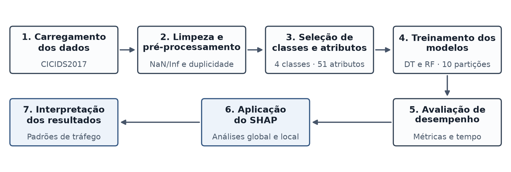

# DDoS, Port Scan, and Brute Force Detection with Machine Learning and TreeSHAP

[**Português**](README.md) | **English**

Official repository for the undergraduate thesis (*Trabalho de Conclusão de Curso*, TCC) in Information Systems at the **State University of Santa Catarina (UDESC — CEPLAN)**, Brazil.

- **Author:** Mateus Adada
- **Advisor:** Prof. Alex Luiz de Sousa
- **Institution:** UDESC — Centro de Educação do Planalto Norte (CEPLAN), São Bento do Sul, Santa Catarina, Brazil

---

## Table of contents

1. [Overview](#overview)
2. [Technologies](#technologies)
3. [Methodology](#methodology)
4. [Key results](#key-results)
5. [Repository structure](#repository-structure)
6. [Requirements and setup](#requirements-and-setup)
7. [Downloading and preparing the dataset](#downloading-and-preparing-the-dataset)
8. [Execution order (full reproduction)](#execution-order-full-reproduction)
9. [Quick SHAP demonstration](#quick-shap-demonstration)
10. [Limitations](#limitations)
11. [References](#references)
12. [License](#license)

---

## Overview

Network-based Intrusion Detection Systems (NIDS) using Machine Learning can achieve high accuracy on academic datasets, but their predictions often provide little insight into which traffic characteristics influenced each decision.

This study develops, evaluates, and interprets **Decision Tree (DT)** and **Random Forest (RF)** classifiers for multiclass detection of **DDoS**, **Port Scan**, and **Brute Force** attacks, alongside normal (**Benign**) traffic, using the public **CICIDS2017** dataset.

Building on the experimental approach of Silva Neto and Gomes (2019), the project uses **TreeSHAP** to provide global explanations (by class) and local explanations (for individual predictions and misclassifications), while keeping the original units of the network features.

---

## Technologies

- **Python** `3.14.4` (environment validated on Ubuntu 26.04.1 LTS through WSL2)
- **pandas** `3.1.0` and **pyarrow** `26.0.0` (tabular data processing and Parquet files)
- **numpy** `2.5.4` (array operations and exact feature-vector grouping)
- **scikit-learn** `1.9.1` (Decision Tree, Random Forest, `StratifiedKFold`, `StratifiedGroupKFold`)
- **shap** `0.54.1` (`TreeExplainer` for global and local explanations)
- **matplotlib** `3.11.2`, **seaborn** `0.13.2`, and **joblib** `1.6.0`

---

## Methodology



The experiment is organized into four main scripts, executed in order:

1. **Preprocessing (`01_preprocessamento.py`):** reads the eight official CICIDS2017 CSV files, removes the duplicate `Fwd Header Length.1` column (leaving 77 features), discards 2,867 rows containing `NaN`/`Infinity`, and keeps the four target classes (**2,571,981 valid flows**).
2. **Data audit (`02_auditoria_dados.py`):** identifies constant columns (8), numerically identical column pairs, duplicate records in `float64` versus `float32` (10.55% excess copies with matching features and labels in `float32`), and conflicting labels (567 feature-vector groups; 1,627 rows).
3. **Training and evaluation (`03_treinamento_avaliacao.py`):** evaluates DT and RF with 10-fold cross-validation under three scenarios:
   - **Baseline:** all 77 features (`StratifiedKFold`);
   - **MDI feature selection:** retains features accounting for at least 99% of cumulative Mean Decrease in Impurity (MDI), calculated **only from the training portion of each fold** (`StratifiedKFold`), with an average of **52.8 features**. This prevents feature-selection leakage from the test folds;
   - **Grouped evaluation:** `StratifiedGroupKFold` keeps identical feature vectors together so they cannot appear in both training and test sets (an average of **52.5 features**).
4. **TreeSHAP explainability (`04_explicabilidade_shap.py`):** applies `TreeExplainer` to the Fold 10 models using the same balanced test subsample of **1,200 flows** (300 per class), checks local additivity over 54 features, and analyzes four cases (three correct classifications and one `PortScan` false negative).

---

## Key results

| Protocol / scenario | Model | Features (average) | Weighted F1-score | Macro F1-score | Test time (s) |
| :--- | :--- | :---: | :---: | :---: | :---: |
| `StratifiedKFold` (77 features) | Decision Tree | 77.0 | `0.9991 ± 0.0001` | `0.9980 ± 0.0003` | `0.024` |
| `StratifiedKFold` (77 features) | Random Forest | 77.0 | `0.9993 ± 0.0001` | `0.9985 ± 0.0001` | `0.209` |
| **`StratifiedKFold` (training-fold MDI)** | **Decision Tree** | **52.8** | **`0.9991 ± 0.0001`** | **`0.9979 ± 0.0003`** | **`0.014`** |
| **`StratifiedKFold` (training-fold MDI)** | **Random Forest** | **52.8** | **`0.9993 ± 0.0001`** | **`0.9985 ± 0.0001`** | **`0.157`** |
| `StratifiedGroupKFold` (training-fold MDI) | Decision Tree | 52.5 | `0.9991 ± 0.0001` | `0.9979 ± 0.0003` | `0.012` |
| `StratifiedGroupKFold` (training-fold MDI) | Random Forest | 52.5 | `0.9994 ± 0.0000` | `0.9985 ± 0.0001` | `0.154` |

- **Fewer classification errors:** across 2,571,981 out-of-fold predictions, Random Forest reduced total errors by **23.25%** (from 2,219 with DT to 1,703 with RF), and reduced `PortScan` false negatives by **41.72%** (from 1,141 to 665).
- **Global TreeSHAP explanations:** the five most influential features accounted for **78.22%** of the total SHAP impact in Decision Tree, compared with **30.11%** in Random Forest.
- **Additivity check:** the maximum difference between `E[f(X)] + sum(SHAP)` and `predict_proba` was `1.77e-14` for DT and `1.16e-13` for RF.

The final CSV reports and figures are catalogued in [`resultados/README.md`](resultados/README.md) (in Portuguese).

---

## Repository structure

```text
treeshap-tcc-udesc/
├── README.md
├── README.en.md
├── LICENSE
├── .gitignore
├── requirements.txt
├── dados/
│   ├── README.md                      # Instructions for downloading the eight official CICIDS2017 CSVs
│   └── processados/                   # Local output for the cleaned Parquet file (not committed)
├── scripts/
│   ├── utils.py                       # Relative paths, class mapping, and exact-vector grouping
│   ├── 01_preprocessamento.py         # Data cleaning and four-class filtering
│   ├── 02_auditoria_dados.py          # Duplicates, label conflicts, float64 vs. float32
│   ├── 03_treinamento_avaliacao.py    # Cross-validation (three scenarios) and confusion matrices
│   └── 04_explicabilidade_shap.py     # Paired TreeSHAP (1,200 flows) and four case studies
├── resultados/
│   ├── README.md                      # Index of audited results
│   ├── auditoria/                     # Data cleaning, duplicate, and label-conflict CSV reports
│   ├── metricas/                      # Metrics, MDI history, and confusion matrices
│   ├── shap/                          # Global SHAP rankings and local case-study CSV reports
│   └── figuras/                       # Final thesis figures (300–400 DPI)
├── modelos/                           # Local output for .joblib models and Parquet samples (not committed)
└── exemplo/
    ├── README.md                      # Static demonstration: Brute Force and PortScan error
    └── 05_demo_alerta_shap.py         # Executable demonstration (model or precomputed mode)
```

---

## Requirements and setup

The experiments were run with **Python 3.14.4** on **Ubuntu 26.04.1 LTS (WSL2)**, on a computer equipped with an Intel Core Ultra 7 255HX processor (20 cores) and 32 GB of RAM (15 GiB allocated to WSL2). Full reproduction processes more than 2.5 million records and requires sufficient memory. Browsing the results and running the precomputed demonstration do not require training the models.

### Linux / WSL2

```bash
git clone https://github.com/mateusadada/treeshap-tcc-udesc.git
cd treeshap-tcc-udesc
python3 -m venv venv
source venv/bin/activate
pip install --upgrade pip
pip install -r requirements.txt
```

### Windows (PowerShell)

```powershell
git clone https://github.com/mateusadada/treeshap-tcc-udesc.git
cd treeshap-tcc-udesc
python -m venv venv
.\venv\Scripts\Activate.ps1
pip install --upgrade pip
pip install -r requirements.txt
```

---

## Downloading and preparing the dataset

To **reproduce the entire experiment from scratch**, download the eight official CICIDS2017 CSV files from the `MachineLearningCSV` collection and place them in `dados/`. The full instructions and exact filenames are listed in [`dados/README.md`](dados/README.md) (in Portuguese).

> **You do not need to download CICIDS2017** if you only want to inspect the published results or use the precomputed demonstration.

---

## Execution order (full reproduction)

With the virtual environment activated and the eight official CSV files placed in `dados/`, run the scripts from the repository root:

```bash
python3 scripts/01_preprocessamento.py
python3 scripts/02_auditoria_dados.py
python3 scripts/03_treinamento_avaliacao.py
python3 scripts/04_explicabilidade_shap.py
```

- `01_preprocessamento.py` creates `dados/processados/cicids2017_4classes_limpo.parquet` and saves data cleaning reports to `resultados/auditoria/`.
- `02_auditoria_dados.py` exports the structural audit reports (duplicates, label conflicts, and `StratifiedGroupKFold`) to `resultados/auditoria/`.
- `03_treinamento_avaliacao.py` trains and evaluates all three scenarios (10 folds each), saves metrics and confusion matrices to `resultados/metricas/` and `resultados/figuras/`, and exports the Fold 10 models and samples to `modelos/`.
- `04_explicabilidade_shap.py` calculates paired TreeSHAP values and generates its tables and figures in `resultados/shap/` and `resultados/figuras/`.

---

## Quick SHAP demonstration

See [`exemplo/README.md`](exemplo/README.md) (in Portuguese) for a static demonstration directly on GitHub (a correct `Brute Force` classification and a `PortScan` false negative), or run the demonstration script:

```bash
# Immediately display audited, precomputed results (available after cloning)
python3 exemplo/05_demo_alerta_shap.py --caso bruteforce --modo precalculado

# Display the misclassified PortScan example
python3 exemplo/05_demo_alerta_shap.py --caso erro_portscan --modo precalculado
```

If you have run `03_treinamento_avaliacao.py` (or downloaded optional Fold 10 artifacts from the repository's **Releases** section, if made available, into `modelos/`), you can also run inference with the saved Random Forest model and TreeSHAP:

```bash
python3 exemplo/05_demo_alerta_shap.py --caso bruteforce --modo modelo --salvar-grafico
```

> The CLI arguments remain in Portuguese because they are part of the existing Python script; translating them would break the commands.

---

## Limitations

- The experiments were performed **offline**, using previously extracted CSV data and four classes from CICIDS2017; they were not validated on production networks or independent datasets.
- The tabular features summarize network flows and do not replace inspection of packet captures (PCAP) or application logs.
- The study does not implement real-time packet capture or measure the cost of online flow extraction (for example, using TShark or CICFlowMeter).

---

## References

- **CICIDS2017:** SHARAFALDIN, I.; LASHKARI, A. H.; GHORBANI, A. A. *Toward generating a new intrusion detection dataset and intrusion traffic characterization.* In: Proceedings of the 4th International Conference on Information Systems Security and Privacy (ICISSP), 2018, pp. 108–116.
- **Baseline study (GREat/UFC):** SILVA NETO, M. G. da; GOMES, D. G. *Network intrusion detection systems design: A machine learning approach.* In: Anais do XXXVII Simpósio Brasileiro de Redes de Computadores e Sistemas Distribuídos (SBRC). Porto Alegre: SBC, 2019, pp. 932–945.
- **SHAP and TreeSHAP:** LUNDBERG, S. M.; LEE, S.-I. *A unified approach to interpreting model predictions.* NeurIPS, 2017. | LUNDBERG, S. M. et al. *From local explanations to global understanding with explainable AI for trees.* Nature Machine Intelligence, vol. 2, no. 1, pp. 56–67, 2020.

---

## License

This project is distributed under the **MIT License**. See [`LICENSE`](LICENSE) for details. The CICIDS2017 dataset remains subject to the original terms of use established by the **Canadian Institute for Cybersecurity (UNB)**.
