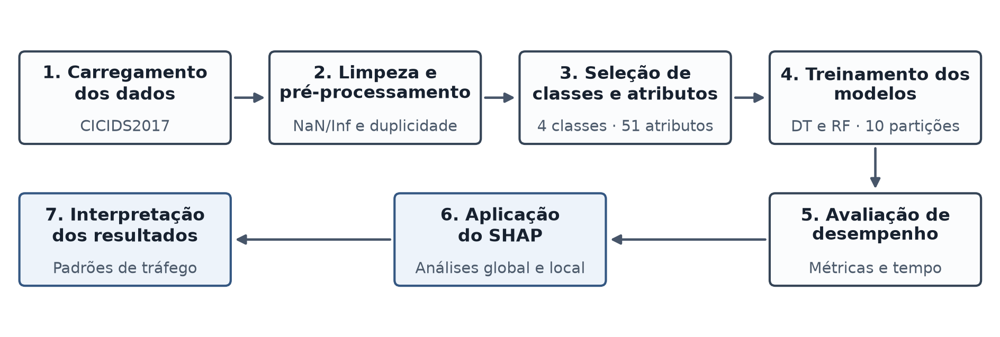

# Detecção de DDoS, Port Scan e Brute Force com Machine Learning e TreeSHAP

Repositório oficial do Trabalho de Conclusão de Curso (TCC) do Bacharelado em Sistemas de Informação da **Universidade do Estado de Santa Catarina (UDESC — CEPLAN)**.

- **Autor:** Mateus Adada
- **Orientador:** Prof. Alex Luiz de Sousa
- **Instituição:** UDESC — Centro de Educação do Planalto Norte (CEPLAN), São Bento do Sul/SC

---

## Sumário

1. [Visão geral](#visão-geral)
2. [Tecnologias utilizadas](#tecnologias-utilizadas)
3. [Metodologia](#metodologia)
4. [Principais resultados](#principais-resultados)
5. [Estrutura do repositório](#estrutura-do-repositório)
6. [Pré-requisitos e instalação](#pré-requisitos-e-instalação)
7. [Download e preparação dos dados](#download-e-preparação-dos-dados)
8. [Ordem de execução (Reprodução completa)](#ordem-de-execução-reprodução-completa)
9. [Demonstração rápida com SHAP](#demonstração-rápida-com-shap)
10. [Limitações do trabalho](#limitações-do-trabalho)
11. [Referências](#referências)
12. [Licença](#licença)

---

## Visão geral

Sistemas de Detecção de Intrusão baseados em rede (NIDS) com Aprendizado de Máquina atingem altas taxas de acerto em bases acadêmicas, mas frequentemente funcionam como modelos "caixa-preta", retornando apenas o rótulo da classificação sem indicar quais características do tráfego motivaram cada decisão.

Este trabalho desenvolve, avalia e interpreta classificadores baseados em **Decision Tree (DT)** e **Random Forest (RF)** para a detecção multiclasse dos ataques **DDoS**, **Port Scan** e **Brute Force**, além do tráfego normal (**Benign**), sobre o *dataset* público **CICIDS2017**. Estendendo o protocolo experimental de Silva Neto e Gomes (2019), integra-se o algoritmo **TreeSHAP** para gerar explicações globais (por classe) e locais (para alertas individuais e análise de erros), mantendo os atributos em suas escalas originais.

---

## Tecnologias utilizadas

- **Python** `3.14.4` (ambiente validado em Ubuntu 26.04.1 LTS via WSL2)
- **pandas** `3.1.0` e **pyarrow** `26.0.0` (manipulação tabular e armazenamento Parquet)
- **numpy** `2.5.4` (operações vetorizadas e agrupamento exato de vetores)
- **scikit-learn** `1.9.1` (Decision Tree, Random Forest, `StratifiedKFold`, `StratifiedGroupKFold`)
- **shap** `0.54.1` (`TreeExplainer` para explicabilidade global e local)
- **matplotlib** `3.11.2`, **seaborn** `0.13.2` e **joblib** `1.6.0`

---

## Metodologia



O experimento organiza-se em quatro scripts principais (executados em sequência):

1. **Pré-processamento (`01_preprocessamento.py`):** carrega os 8 arquivos CSV oficiais do CICIDS2017, remove a coluna repetida `Fwd Header Length.1` (restando 77 atributos), exclui 2.867 linhas com `NaN`/`Infinity` e filtra as quatro classes do escopo (**2.571.981 fluxos válidos**).
2. **Auditoria dos dados (`02_auditoria_dados.py`):** identifica colunas constantes (8), pares numericamente idênticos, proporção de registros duplicados em `float64` vs. `float32` (10,55% de cópias excedentes puras em `float32`) e grupos com rótulos conflitantes (567 grupos; 1.627 linhas).
3. **Treinamento e avaliação (`03_treinamento_avaliacao.py`):** avalia DT e RF em validação cruzada de 10 partições sob três cenários:
   - *Baseline* com todos os 77 atributos (`StratifiedKFold`);
   - Seleção via **MDI** ($\ge 99\%$ da importância acumulada) executada **exclusivamente no conjunto de treino de cada partição** (`StratifiedKFold`), retendo média de **52,8 atributos** e eliminando vazamento de dados;
   - Avaliação complementar com `StratifiedGroupKFold`, impedindo que vetores de atributos idênticos apareçam simultaneamente no treino e no teste (média de **52,5 atributos**).
4. **Explicabilidade com TreeSHAP (`04_explicabilidade_shap.py`):** aplica o `TreeExplainer` sobre os modelos do Fold 10 na mesma subamostra balanceada de **1.200 fluxos de teste** (300 por classe), verifica a aditividade local nos 54 atributos e analisa 4 estudos de caso (3 acertos + 1 falso negativo de `PortScan`).

---

## Principais resultados

| Protocolo / Cenário | Modelo | Atributos (média) | F1-Score Ponderado | F1-Macro | Tempo de Teste (s) |
| :--- | :--- | :---: | :---: | :---: | :---: |
| `StratifiedKFold` (77 atributos) | Decision Tree | 77,0 | `0,9991 ± 0,0001` | `0,9980 ± 0,0003` | `0,024` |
| `StratifiedKFold` (77 atributos) | Random Forest | 77,0 | `0,9993 ± 0,0001` | `0,9985 ± 0,0001` | `0,209` |
| **`StratifiedKFold` (MDI no treino)** | **Decision Tree** | **52,8** | **`0,9991 ± 0,0001`** | **`0,9979 ± 0,0003`** | **`0,014`** |
| **`StratifiedKFold` (MDI no treino)** | **Random Forest** | **52,8** | **`0,9993 ± 0,0001`** | **`0,9985 ± 0,0001`** | **`0,157`** |
| `StratifiedGroupKFold` (MDI no treino) | Decision Tree | 52,5 | `0,9991 ± 0,0001` | `0,9979 ± 0,0003` | `0,012` |
| `StratifiedGroupKFold` (MDI no treino) | Random Forest | 52,5 | `0,9994 ± 0,0000` | `0,9985 ± 0,0001` | `0,154` |

- **Redução de erros:** nas matrizes de confusão acumuladas (2.571.981 fluxos), o Random Forest reduziu o total de erros em **23,25%** (de 2.219 na DT para 1.703 no RF) e diminuiu os falsos negativos de `PortScan` em **41,72%** (de 1.141 para 665).
- **Explicabilidade global (TreeSHAP):** a Decision Tree concentrou **78,22%** do impacto SHAP nos 5 primeiros atributos, enquanto o Random Forest distribuiu o peso de forma mais equilibrada (**30,11%** nos 5 primeiros).
- **Verificação de aditividade:** o erro máximo entre `E[f(X)] + sum(SHAP)` e `predict_proba` foi de `1,77e-14` (DT) e `1,16e-13` (RF).

Todos os arquivos CSV e gráficos finais estão catalogados em [`resultados/README.md`](resultados/README.md).

---

## Estrutura do repositório

```text
treeshap-tcc-udesc/
├── README.md
├── LICENSE
├── .gitignore
├── requirements.txt
├── dados/
│   ├── README.md                      # Instruções para baixar os 8 CSVs oficiais do CICIDS2017
│   └── processados/                   # Destino local do Parquet limpo (fora do Git)
├── scripts/
│   ├── utils.py                       # Caminhos relativos, mapa de classes e agrupamento exato
│   ├── 01_preprocessamento.py         # Limpeza de ruídos e recorte das 4 classes
│   ├── 02_auditoria_dados.py          # Duplicatas, conflitos de rótulo e float64 vs. float32
│   ├── 03_treinamento_avaliacao.py    # Validação cruzada (3 cenários) e matrizes de confusão
│   └── 04_explicabilidade_shap.py     # TreeSHAP pareado (1.200 fluxos) e 4 estudos de caso
├── resultados/
│   ├── README.md                      # Índice de todos os resultados auditados
│   ├── auditoria/                     # CSVs de limpeza, duplicatas e conflitos
│   ├── metricas/                      # CSVs de métricas, histórico MDI e matrizes de confusão
│   ├── shap/                          # CSVs de ranking global SHAP e estudos de caso locais
│   └── figuras/                       # Gráficos finais do TCC (300–400 DPI)
├── modelos/                           # Destino local para .joblib e amostras Parquet (fora do Git)
└── exemplo/
    ├── README.md                      # Demonstração estática (Brute Force + Erro PortScan)
    └── 05_demo_alerta_shap.py         # Demonstração executável (modo modelo e pré-calculado)
```

---

## Pré-requisitos e instalação

Os experimentos foram validados com **Python 3.14.4** em **Ubuntu 26.04.1 LTS (WSL2)** sobre uma máquina com processador Intel Core Ultra 7 255HX (20 núcleos) e 32 GB de RAM física (15 GiB alocados ao WSL2). A reprodução completa processa mais de 2,5 milhões de registros e exige memória RAM adequada; já a consulta aos resultados e a demonstração pré-calculada funcionam em qualquer máquina comum.

### Linux / WSL2

```bash
git clone https://github.com/mateusadada/treeshap-tcc-udesc.git
cd treeshap-tcc-udesc
python3 -m venv venv
source venv/bin/activate
pip install --upgrade pip
pip install -r requirements.txt
```

### Windows (PowerShell)

```powershell
git clone https://github.com/mateusadada/treeshap-tcc-udesc.git
cd treeshap-tcc-udesc
python -m venv venv
.\venv\Scripts\Activate.ps1
pip install --upgrade pip
pip install -r requirements.txt
```

---

## Download e preparação dos dados

Para **reproduzir o experimento completo do zero**, baixe os oito arquivos CSV oficiais da pasta `MachineLearningCSV` do CICIDS2017 e coloque-os em `dados/`. As instruções completas e a lista exata de arquivos esperados estão em [`dados/README.md`](dados/README.md).

> Se o seu objetivo for apenas consultar os resultados ou testar a demonstração rápida, **não é necessário baixar o CICIDS2017**.

---

## Ordem de execução (Reprodução completa)

Com o ambiente virtual ativado e os 8 arquivos CSV oficiais posicionados em `dados/`, execute os scripts a partir da raiz do projeto:

```bash
python3 scripts/01_preprocessamento.py
python3 scripts/02_auditoria_dados.py
python3 scripts/03_treinamento_avaliacao.py
python3 scripts/04_explicabilidade_shap.py
```

* `01_preprocessamento.py` gera `dados/processados/cicids2017_4classes_limpo.parquet` e os relatórios de limpeza em `resultados/auditoria/`.
* `02_auditoria_dados.py` exporta a auditoria estrutural (duplicatas, conflitos e `StratifiedGroupKFold`) em `resultados/auditoria/`.
* `03_treinamento_avaliacao.py` treina e avalia os 3 cenários (10 *folds* cada), salva métricas e matrizes de confusão em `resultados/metricas/` e `resultados/figuras/` e exporta os modelos/amostras do Fold 10 em `modelos/`.
* `04_explicabilidade_shap.py` calcula o TreeSHAP pareado e gera todas as tabelas e gráficos SHAP em `resultados/shap/` e `resultados/figuras/`.

---

## Demonstração rápida com SHAP

Consulte [`exemplo/README.md`](exemplo/README.md) para ver a demonstração estática diretamente no GitHub (Estudo de Caso de `Brute Force` e Estudo de Caso do Falso Negativo de `PortScan`) ou execute o script de demonstração:

```bash
# Consulta imediata aos resultados auditados (funciona logo após clonar o repositório)
python3 exemplo/05_demo_alerta_shap.py --caso bruteforce --modo precalculado

# Para visualizar o caso de erro de classificação (Falso Negativo de PortScan)
python3 exemplo/05_demo_alerta_shap.py --caso erro_portscan --modo precalculado
```

Caso você tenha executado o script `03_treinamento_avaliacao.py` (ou baixado os artefatos opcionais do Fold 10 pela aba **Releases** do repositório, caso disponibilizados, para a pasta `modelos/`), também é possível rodar a inferência real do Random Forest + TreeSHAP:

```bash
python3 exemplo/05_demo_alerta_shap.py --caso bruteforce --modo modelo --salvar-grafico
```

---

## Limitações do trabalho

- Os experimentos foram conduzidos de forma *offline* sobre arquivos CSV pré-extraídos de quatro classes do CICIDS2017, sem validação em redes de produção ou em bases independentes.
- Os atributos tabulares representam estatísticas agregadas de fluxo e não substituem a inspeção direta de pacotes (PCAP) ou *logs* de aplicação.
- O estudo não implementa captura de tráfego em tempo real nem avalia o custo de extração de fluxos em linha (ex.: TShark ou CICFlowMeter).

---

## Referências

- **CICIDS2017:** SHARAFALDIN, I.; LASHKARI, A. H.; GHORBANI, A. A. Toward generating a new intrusion detection dataset and intrusion traffic characterization. In: *Proceedings of the 4th International Conference on Information Systems Security and Privacy (ICISSP)*, 2018. p. 108–116.
- **Estudo base (GREat/UFC):** SILVA NETO, M. G. da; GOMES, D. G. Network intrusion detection systems design: A machine learning approach. In: *Anais do XXXVII Simpósio Brasileiro de Redes de Computadores e Sistemas Distribuídos (SBRC)*. Porto Alegre: SBC, 2019. p. 932–945.
- **SHAP e TreeSHAP:** LUNDBERG, S. M.; LEE, S.-I. A unified approach to interpreting model predictions. *NeurIPS*, 2017. | LUNDBERG, S. M. et al. From local explanations to global understanding with explainable AI for trees. *Nature Machine Intelligence*, v. 2, n. 1, p. 56–67, 2020.

---

## Licença

Este projeto é distribuído sob a licença **MIT**. Consulte o arquivo [`LICENSE`](LICENSE) para mais detalhes. O *dataset* CICIDS2017 permanece sujeito aos termos de uso originais do *Canadian Institute for Cybersecurity* (UNB).
