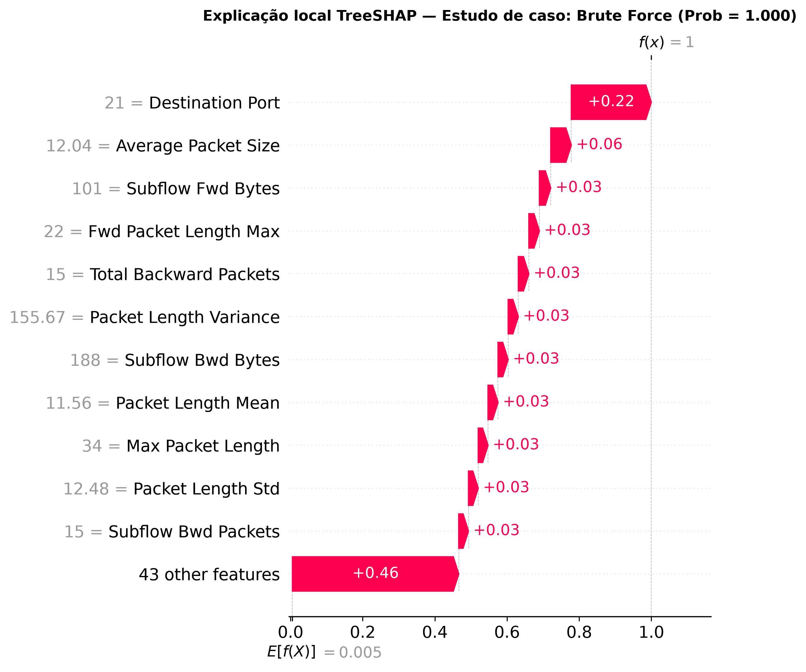
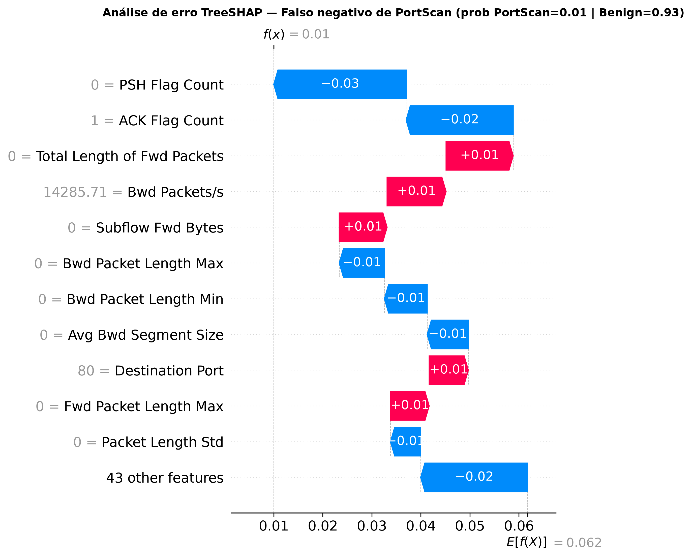

# Exemplo Prático de Explicabilidade com TreeSHAP

Esta pasta apresenta duas formas de visualizar como o algoritmo **TreeSHAP** transforma a saída de um classificador Random Forest em uma explicação legível para um analista de segurança:

1. **Demonstração estática (abaixo):** resultados reais e figuras *waterfall* prontas para consulta direta no GitHub, sem necessidade de executar código.
2. **Demonstração executável (`05_demo_alerta_shap.py`):** script Python capaz de rodar tanto sobre o modelo treinado local quanto em modo de consulta aos resultados pré-calculados.

> **Aviso metodológico:** todos os exemplos derivam de registros de teste *offline* do CICIDS2017 em formato CSV (estatísticas agregadas de fluxo). O SHAP explica quais atributos influenciaram a decisão do modelo, mas **não substitui** a inspeção de pacotes brutos (PCAP) nem os registros de *log* dos servidores.

---

## Caso A — Classificação Correta: Ataque Brute Force (Amostra 900)

* **Classe real / predita:** `Brute Force`
* **Probabilidade base esperada ($E[f(X)]$):** `0,0054` (0,54%)
* **Probabilidade estimada pelo Random Forest ($f(x)$):** `1,0000` (100,0%)

| Rank | Atributo do fluxo | Valor observado | Contribuição SHAP | Efeito na predição |
| :---: | :--- | :---: | :---: | :--- |
| 1 | `Destination Port` | `21` | `+0,2217` | Aumenta a probabilidade |
| 2 | `Average Packet Size` | `12,04 bytes` | `+0,0570` | Aumenta a probabilidade |
| 3 | `Subflow Fwd Bytes` | `101 bytes` | `+0,0314` | Aumenta a probabilidade |
| 4 | `Fwd Packet Length Max` | `22 bytes` | `+0,0292` | Aumenta a probabilidade |
| 5 | `Total Backward Packets` | `15 pacotes` | `+0,0292` | Aumenta a probabilidade |
| — | Demais 49 atributos | — | `+0,6261` | Aumentam a probabilidade |

**Leitura prática para um analista:** a predição foi impulsionada pela combinação da porta `21` (padrão do protocolo FTP) com pacotes curtos e baixo volume de bytes trocados na conexão. Como os CSVs não contêm o conteúdo dos pacotes, o alerta orientaria o analista a auditar os *logs* de autenticação do servidor FTP ou a captura PCAP correspondente para confirmar tentativas repetidas de acesso.



---

## Caso B — Análise de Erro: Falso Negativo de PortScan

* **Classe real:** `PortScan` | **Classe predita pelo Random Forest:** `Benign` (`0,9300` para `Benign`; `0,0100` para `PortScan`)
* **Decomposição para a classe verdadeira (`PortScan`):** base $E[f(X)] = 0,0618 \rightarrow f(x) = 0,0100$ (soma SHAP $= -0,0518$)

| Rank | Atributo do fluxo | Valor observado | Contribuição SHAP (`PortScan`) | Efeito na predição |
| :---: | :--- | :---: | :---: | :--- |
| 1 | `PSH Flag Count` | `0` | `-0,0270` | Reduz a probabilidade |
| 2 | `ACK Flag Count` | `1` | `-0,0218` | Reduz a probabilidade |
| 3 | `Total Length of Fwd Packets` | `0 bytes` | `+0,0137` | Aumenta a probabilidade |
| 4 | `Bwd Packets/s` | `14.285,71` | `+0,0120` | Aumenta a probabilidade |
| 5 | `Subflow Fwd Bytes` | `0 bytes` | `+0,0098` | Aumenta a probabilidade |
| 6 | `Bwd Packet Length Max` | `0 bytes` | `-0,0092` | Reduz a probabilidade |

**Leitura prática para um analista:** embora o envio sem carga útil (`0 bytes`) e a alta taxa de retorno tenham empurrado o fluxo para `PortScan`, a ausência da *flag* `PSH`, a presença de `ACK = 1` e respostas com `0 bytes` levaram o classificador a tratá-lo como tráfego `Benign`. Esse caso mostra como o TreeSHAP também ajuda a auditar falhas do modelo em fluxos estatisticamente ambíguos.



---

## Como executar a demonstração (`05_demo_alerta_shap.py`)

O script possui dois modos claramente identificados na saída do terminal:

* **Modo consulta pré-calculada (sem modelo `.joblib`):** lê diretamente `resultados/shap/estudos_de_caso_locais_shap_auditado.csv`, funcionando imediatamente após clonar o repositório.
* **Modo execução ao vivo do modelo:** carrega `modelos/modelo_rf_mdi_fold10.joblib` e as amostras de teste em `modelos/`, executa `predict_proba` e calcula o `TreeExplainer` em tempo de execução.

```bash
# Modo automático (usa o modelo local se existir; caso contrário, usa o CSV auditado)
python3 exemplo/05_demo_alerta_shap.py --caso bruteforce

# Outros casos disponíveis: ddos, portscan, erro_portscan
python3 exemplo/05_demo_alerta_shap.py --caso erro_portscan

# Forçar consulta aos resultados pré-calculados (não requer .joblib)
python3 exemplo/05_demo_alerta_shap.py --caso bruteforce --modo precalculado

# Forçar execução real do modelo + salvar gráfico waterfall gerado na hora
python3 exemplo/05_demo_alerta_shap.py --caso bruteforce --modo modelo --salvar-grafico
```
